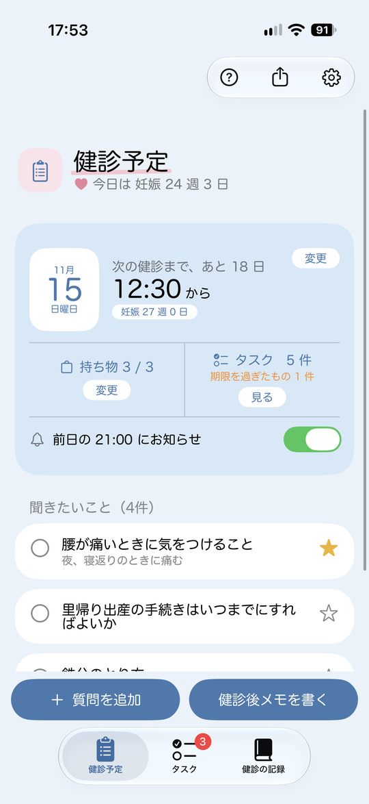
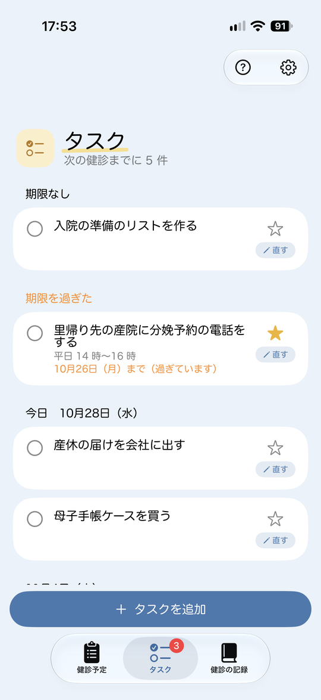
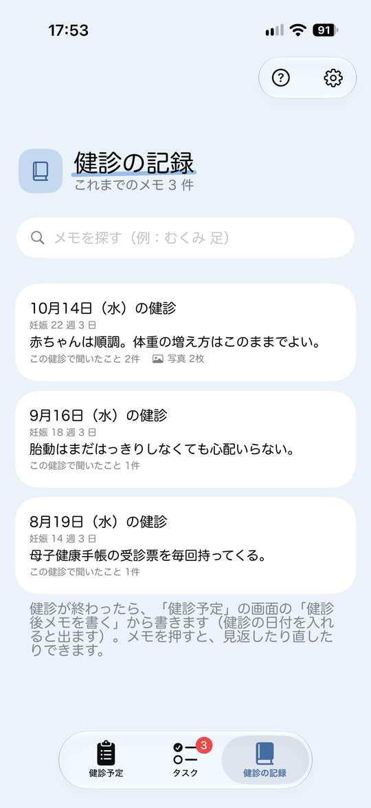
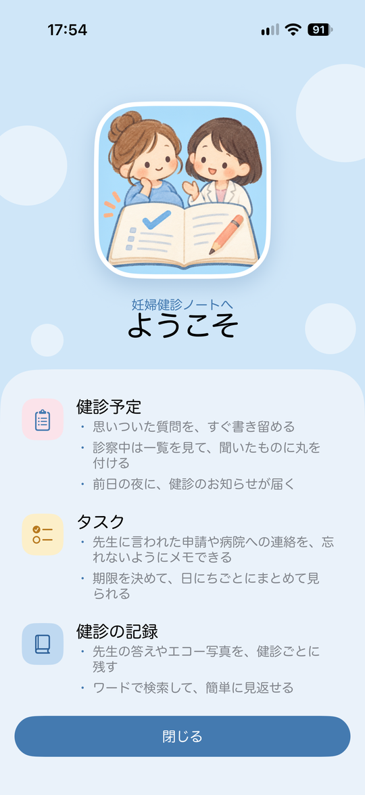
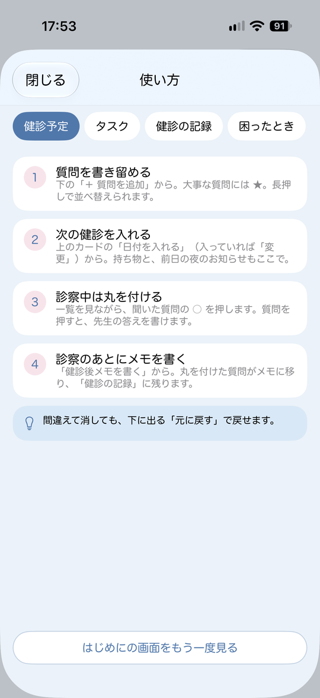
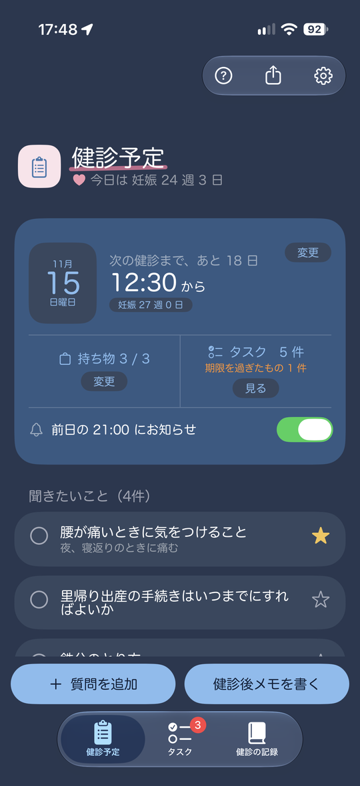
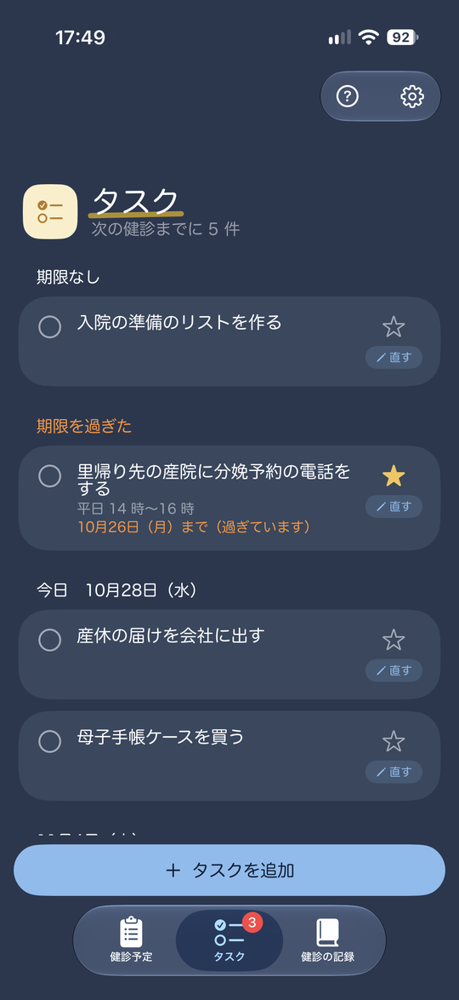
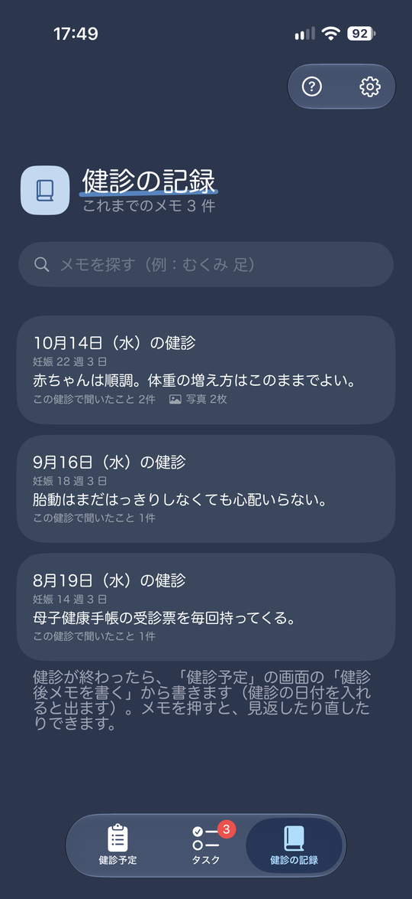
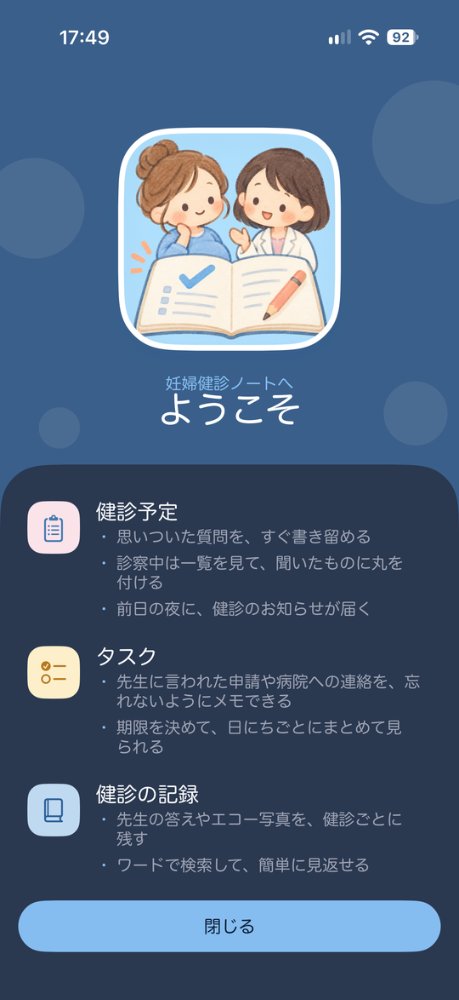
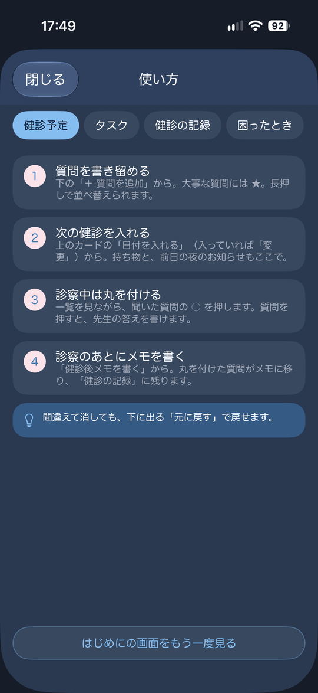

# 妊婦健診ノート

妊婦健診で聞きたいことを書き留めて、診察では一覧を見ながら聞き、先生の答えを「健診後メモ」に残して、あとから見返せる iOSアプリです。次の健診の日付・持ち物・前日の夜のお知らせと、健診と健診の間にすること（タスク）も扱います。

<p>
  
  
  
  
  
</p>

左から、健診予定・タスク・健診の記録・はじめに（ようこそ）・使い方。写真は開発用のサンプルデータで撮りました（本当の記録ではありません）。紹介動画：準備中

<details>
<summary>ダークモードの画面</summary>

<p>
  
  
  
  
  
</p>

</details>

## 作成理由

妻が妊娠し、妊婦健診に付き添う中で、次のような困りごとがあり作成を決めました。

- 健診の前に「先生に聞きたいこと」を思いついても、診察までに忘れてしまうことがある
- 診察の時間は短く、聞いたことの答えをその場で０からメモしきれない
- 前回の健診で何を言われたか、あとから見返したい

紙のメモやメモアプリでも事前準備で可能ですが、自らの考えた専用のアプリで「書き留める → 診察で聞く → 答えを残す → あとで見返す」の流れを 1 つにまとめたくて作りました。
作りながら妻に何度も触ってもらい意見をもらいながら修正し作成しました。[ADR 0005](docs/adr/0005-simplify-to-v0.4.md)）。

## できること

- **健診予定**：聞きたいことを書き留める（大事なものに ★、長押しで並べ替え）。診察中は一覧を見て、聞いたものにチェックを付ける。次の健診の日付・時刻・持ち物、前日の夜に通知でお知らせ。「あと何日」と妊娠週数も出る
- **健診後メモ**：先生の答えと説明、書類やエコー写真等（5 枚まで）を残す。チェックを付けた質問がメモに移る
- **健診の記録**：これまでのメモを見返す・直す・消す。ワードで検索できる。メモを文章で共有できる
- **タスク**：先生に言われた申請や病院への連絡を、期限つきで残す。健診後メモから追加もできる
- **はじめに・使い方**：初めて開いたときの「ようこそ」と出産予定日の入力。操作方法が分からなくなっても各画面の右上の「？」から使い方を見られる
- 消したものは、下に出る「元に戻す」で戻せる。書きかけのメモや質問は、閉じても残る
- 記録はこの iPhone の中だけに保存し、外には送らない

## 設計で気をつけた部分

健康の記録なので、**書いたものを失わないこと** をいちばん大事にしました。決めたことと理由は [docs/adr](docs/adr) に残しています。

| 気をつけたこと | 決めたこと |
| --- | --- |
| 保存の失敗で記録が中途半端にならない | 1 つの操作を 1 回の保存にまとめ、失敗したら元の状態に戻す（[ADR 0007](docs/adr/0007-one-save-per-operation.md)） |
| 間違えて消しても戻せる | 直前の 1 回だけ「元に戻す」で戻せる（[ADR 0008](docs/adr/0008-undo-the-last-operation.md)） |
| お知らせが記録とずれない | 記録の内容に合わせて、お知らせを予約し直す（[ADR 0010](docs/adr/0010-reminders-follow-the-data.md)） |
| 日付が 1 日ずれない | 日付は年・月・日で持ち、日本時間で計算する（[ADR 0006](docs/adr/0006-dates-in-japan-time.md)） |
| 写真で動きが重くならない | 写真は縮めた写しを保存する（[ADR 0011](docs/adr/0011-photos-belong-to-the-memo-id.md)） |

## テストと確認

- ロジックと保存のテスト 247 件（Swift Testing）と、画面のテスト 4 件（XCUITest）
- プルリクエストごとに、GitHub Actions でビルドとテストを動かしている
- 段階ごとに、シミュレーターと実機で確かめたことと、見つけて直したことを記録している（[docs/verification](docs/verification)）
- 最後に、妻に実機で 8 つの操作を試してもらった（[段階 F の確認](docs/verification/stage-f.md)）

## AIの使い方

このアプリは、AI にコードを書いて貰いながら一緒に作りました。

- **コードは Claudeが書きました。** 自分は Swift の実務経験がなく、現在playground等で学習を進めています。
- **自分がやったこと**：何を作るかを決める（要件定義と、画面の見本を見て形を決める）、シミュレーターと実機で動かして確かめる、気になったところを直してもらう、プルリクエストを出してマージする。妻に使ってもらい、意見を伝えるのも自分の役目でした。
- ChatGPT には、設計のレビューと、アプリのアイコンの絵（画像の生成）を頼みました。
- コードの読み方は勉強中で、自分の言葉で説明できるように学習を進めています。

## まだやっていないこと

- iPhone SE などの小さな画面での確認
- App Store への公開（検討中）

## 動かし方

- 必要なもの：Xcode 27、iOS 26 以降のシミュレーターまたは実機
- `PrenatalCheckupNote.xcodeproj` を開き、スキーム `PrenatalCheckupNote` を選んで実行します。
- 右上の歯車 → 開発用の「サンプルデータを表示する」をオンにすると、添付のように見本の記録で画面を見られます（本当の記録には触れません）。
- テストは Xcode で ⌘U、またはターミナルで次のコマンドを実行します（シミュレーター名は手元の環境に合わせてください）。

```sh
xcodebuild test \
  -project PrenatalCheckupNote.xcodeproj \
  -scheme PrenatalCheckupNote \
  -destination 'platform=iOS Simulator,name=iPhone 17 Pro'
```

## 使っている技術

- Swift 6（言語モード 6、厳格な並行性チェック）
- SwiftUI
- SwiftData（iCloud の同期はしない）
- UserNotifications（前日の夜のお知らせ）
- PhotosUI（写真を選ぶ）
- Swift Testing（ロジックのテスト）、XCUITest（画面のテスト）
- GitHub Actions（プルリクエストごとにビルドとテスト）
